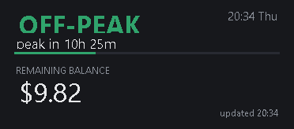
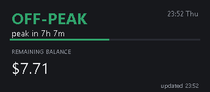

# DeepSeek Status Widget

[](https://github.com/Iftikhar-Omar/deepseek-status-widget/actions/workflows/test.yml)


A tiny always-on-top desktop widget that shows **whether DeepSeek is charging peak or off-peak rates
right now**, when that flips, and **how much balance is left**.



## Why

DeepSeek halves its API rates outside peak hours. Peak is **01:00–04:00 and 06:00–10:00 UTC, Monday
to Friday** — in Asia/Dhaka that is 07:00–10:00 and 12:00–16:00. Everything else, weekends included,
is off-peak at half price.

If you point agents at DeepSeek — DeepSeek Harness, Claude Code, Codex, your own scripts — the
difference between "run this now" and "run this in two hours" is real money. This widget answers that
question at a glance instead of a docs tab.

## Two builds

| | file | platforms | status |
|---|---|---|---|
| Windows native | `PeakWidget.ps1` | Windows 10/11 | tested |
| Cross-platform window | `deepseek_status.py` | Windows, macOS, Linux | tested on Windows; macOS/Linux not verified by the author |
| Status-bar module | `deepseek_status.py --line` / `--waybar` | any OS | tested on Windows |



Both show the same thing and use the same rules. The Python build needs only the standard library
plus tkinter.

## What it shows

| element | source |
|---|---|
| **PEAK / OFF-PEAK** and a countdown to the next change | local rule |
| progress bar through the current window | local rule |
| **remaining balance** (USD, plus granted CNY while any remains) | `GET https://api.deepseek.com/user/balance`, every 5 minutes |
| `updated HH:mm`, or the error if the fetch failed | local |

The Windows build costs roughly **2% of one CPU core** and ~130 MB, the Python build less. Either way
it is one HTTP request every five minutes and a one-second timer that only does arithmetic.

## Requirements

- A DeepSeek API key in the `DEEPSEEK_API_KEY` environment variable — used only to read the balance.
  Without it the schedule still works and the balance shows `n/a`.

```powershell
# Windows (user scope, no admin needed)
[Environment]::SetEnvironmentVariable('DEEPSEEK_API_KEY','sk-...','User')
```

```sh
# macOS / Linux
export DEEPSEEK_API_KEY=sk-...     # add to ~/.zshrc or ~/.bashrc
```

- **Windows build:** Windows PowerShell 5.1 (already installed).
- **Python build:** Python 3.8+ with tkinter. Included in python.org builds; on Debian/Ubuntu install
  `python3-tk`.

## Install

```sh
git clone https://github.com/Iftikhar-Omar/deepseek-status-widget.git
cd deepseek-status-widget
```

**Windows (native):** double-click `Start Widget.vbs` — no console window, no installer.

```powershell
powershell -ExecutionPolicy Bypass -File .\install-startup.ps1   # optional: start at sign-in
```

**Any platform (Python):**

```sh
python3 deepseek_status.py
```

- **Drag** it anywhere; the position is remembered.
- **Right-click** for *Always on top* / *Refresh balance* / *Close widget*.
- The Windows build allows only one instance; launching again exits immediately.

## Linux / macOS status bar

On Linux the native thing is a bar module, not another floating window. The Python build prints the
same status as a line:

```sh
python3 deepseek_status.py --line
# OFF-PEAK - peak in 7h 6m - $7.70
```

**waybar** (`~/.config/waybar/config`):

```json
"custom/deepseek": {
  "exec": "python3 /path/to/deepseek_status.py --waybar",
  "interval": 60,
  "return-type": "json",
  "format": "{}"
}
```

`--waybar` emits `{"text", "tooltip", "class"}`. Style it in `~/.config/waybar/style.css`:

```css
#custom-deepseek.peak { color: #e5484d; }
#custom-deepseek.off-peak { color: #30a46c; }
```

**polybar** (`~/.config/polybar/config.ini`):

```ini
[module/deepseek]
type = custom/script
exec = python3 /path/to/deepseek_status.py --line
interval = 60
```

**i3blocks** (`~/.config/i3blocks/config`):

```ini
[deepseek]
command=python3 /path/to/deepseek_status.py --line
interval=60
```

Each call performs one balance request, so keep the interval at 60 seconds or more.

## Configure

The schedule lives at the top of `PeakWidget.ps1` and `deepseek_status.py` (keep them in sync):

```powershell
$PeakWindowsUtc = @(
    @{ Start = 1; End = 4 }     # UTC hours, end-exclusive
    @{ Start = 6; End = 10 }
)
$CnHolidays = @()               # add 'yyyy-MM-dd' entries; those days become off-peak
```

```python
PEAK_WINDOWS_UTC = ((1, 4), (6, 10))
CN_HOLIDAYS = set()             # add "YYYY-MM-DD" entries
```

Chinese public holidays are off-peak all day per DeepSeek's rules, but they change every year, so
the list is empty by default rather than guessing. Add the dates when the State Council publishes
them.

## How it works

- The schedule is computed locally: UTC hour windows, Beijing-time weekday check, holiday list. No
  network call.
- Balance is one `GET /user/balance` with your key, cached for five minutes, fetched off the UI
  thread so the window never blocks.
- Nothing else leaves your machine. No telemetry, no analytics, no update check.
- **No usage or connection metrics**: DeepSeek has no endpoint for either. `/user/usage`,
  `/user/billing`, `/user/credits`, `/dashboard/billing/usage`, `/user/spend` all return 404. Only
  `/user/balance` exists, so that is all the widget can honestly show.

## Development

```powershell
# Windows build
powershell -NoProfile -Sta -File .\PeakWidget.ps1 -Test              # schedule boundaries, no UI
powershell -NoProfile -Sta -File .\PeakWidget.ps1 -Shot preview.png  # render one frame, exit
```

```sh
# Python build
python3 deepseek_status.py --selftest
```

Four details are load-bearing and easy to break:

- **DPI awareness must be set before the UI exists** (both builds). Without it Windows virtualises
  the process — 1536×864 on a 1920×1080 screen at 125% — then scales the window 1.25× and pushes a
  correctly positioned widget off the right edge.
- **`Add-Type -AssemblyName System.Net.Http`** in the PowerShell build. Windows PowerShell does not
  load it by default, and the failure surfaces as a generic "fetch failed".
- **Tk fonts are sized in points, not pixels.** At 125% scale an 18pt label became ~30px and
  overlapped its neighbours; the Python build uses negative (pixel) sizes.
- **Diagnostic modes bypass the single-instance mutex**, so `-Test` and `-Shot` work while the widget
  is running — which is what CI needs.

## License

MIT — see [LICENSE](LICENSE).

Not affiliated with DeepSeek. "DeepSeek" is a trademark of its owner; this is an unofficial
community tool.
